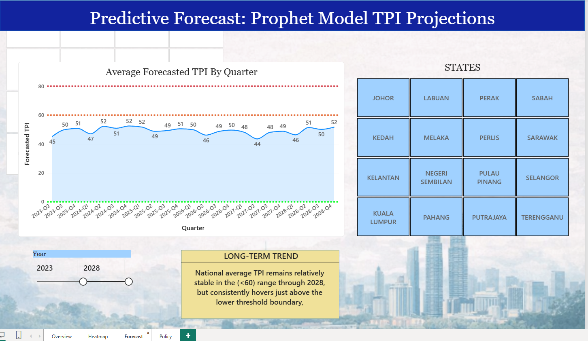

# SeasonShift: A Data-Driven Tourism Pressure Index and Predictive Seasonality Model for Sustainable Tourism Planning in Malaysia

**DOSM Datathon 2026 · Team Avengers · Universiti Putra Malaysia**

SeasonShift is a team analytics project that examines how tourism pressure is distributed across Malaysia's states and federal territories. It combines a quarterly **Tourism Pressure Index (TPI)**, a **Prophet time-series forecast**, and a **visitor-redistribution policy scenario** in an interactive four-page Power BI dashboard.

> This repository contains the submitted Power BI dashboard, the final project report, supporting datasets, and dashboard documentation. The original Python notebook/scripts used for upstream preparation and forecasting were not included in the materials provided for this repository; see [Reproducibility and limitations](#reproducibility-and-limitations).

## Dashboard preview

### 1. National overview


### 2. Historical Tourism Pressure Index


### 3. Prophet forecast



### 4. Policy simulation


## Problem and objectives

Tourism demand is not evenly distributed across Malaysia. Some destinations attract visitor volumes that may place pressure on accommodation and local infrastructure, while other destinations may have capacity to receive more visitors. Looking only at national arrival totals can hide these spatial differences.

The project aims to:

1. Develop a quarterly, state-level Tourism Pressure Index using visitor demand, accommodation capacity, baseline occupancy, and seasonal context.
2. Forecast state-level tourism pressure through 2028 using Prophet.
3. Simulate a visitor-redistribution scenario and estimate how the redistribution could affect tourist spending and selected environmental indicators.
4. Present the analysis in an interactive Power BI dashboard for exploration and decision support.

## Analytical workflow

1. **Collect and prepare data** — bring together quarterly tourist arrivals, hotel inventory, average occupancy rates, calendar indicators, and spatial demand weights.
2. **Allocate demand by state** — derive state-level demand using fixed state demand-share weights; these are modelled allocations, not observed state-level arrival counts.
3. **Construct historical TPI** — combine demand, rooms, baseline average occupancy rate (AOR), and seasonal context into quarterly state-level TPI outputs.
4. **Forecast TPI** — use Prophet to project state-level TPI from 2023-Q2 through 2028-Q4.
5. **Simulate policy scenarios** — compare Business as Usual (BAU) with a SeasonShift redistribution scenario, then explore the outputs in Power BI.

The exact closed-form TPI weighting formula is not documented in the supplied artefacts. The report notes that the index was calculated upstream in Python/Excel and that its exact formula could not be reconstructed from the packaged Power BI file. The repository therefore documents the confirmed inputs and outputs without inventing a formula.

## Key findings

The figures below are based on the submitted report and the CSV outputs included in this repository.

### Historical TPI (2019-Q1 to 2023-Q1)

- The historical output contains **272 state-quarter records** across **16 Malaysian state/federal-territory units**.
- **Pahang** recorded the highest TPI: **82.19 in 2019-Q3**.
- The supplied historical output contains **3 Red-zone records**, all for Pahang in 2019-Q1, 2019-Q2, and 2019-Q3.
- The mean of the supplied historical TPI records is **21.77**.

### Forecast TPI (2023-Q2 to 2028-Q4)

- The forecast output contains **368 state-quarter records** across 16 units and 23 quarters.
- The mean TPI across the supplied forecast records is **49.20**.
- No forecast state-quarter record is classified as Red in the supplied output; the maximum forecast TPI is **74.21** (Pahang, 2025-Q1).
- These are model forecasts under the project's assumptions, not guaranteed future outcomes. Forecast backtesting metrics were not included in the submitted materials.

### Visitor-redistribution scenario

The policy scenario shifts modelled visitor demand away from three selected source hubs — **Kuala Lumpur, Pahang, and Pulau Pinang** — toward four receiving corridors — **Kedah, Kelantan, Perak, and Terengganu**. The three source hubs are case-study policy targets; they should not be described as three states that all crossed the historical TPI Red threshold. The historical output identifies Pahang as the only unit to enter the Red zone.

At the submitted baseline scenario, the dashboard reports approximately **RM49.33 billion** in redistributed spending, **38.07 thousand tonnes** of waste change, and **1.18 million tonnes CO2e** of carbon-footprint change. These dashboard indicators represent the **gross sum of absolute state-level changes** (origin-state reductions plus receiving-state increases). They are not net nationwide savings. In the supplied policy CSV, national totals for spending, waste, and carbon remain effectively unchanged between BAU and the policy scenario, consistent with a zero-sum redistribution design.

The supplied policy CSV implies approximately **5,768,732 one-way visitor reallocations** when the absolute state-level arrival changes are divided by two. The report describes this as approximately 5.79 million; the small difference should be reconciled against the original upstream workbook if an exact figure is required.

## Dashboard pages

| Page | Purpose |
|---|---|
| **Overview** | National tourist-arrival baseline, summary indicators, BAU versus SeasonShift trend, and state selection. |
| **Heatmap** | Historical quarterly TPI by state, with Green, Yellow, and Red pressure categories. |
| **Forecast** | Average and state-level forecast TPI through 2028, with state and year filters. |
| **Policy** | BAU versus redistribution scenario, state-level movements, and a shift-rate what-if control. |

See [`dashboard/README.md`](dashboard/README.md) for opening and navigation instructions.

## Repository contents

```text
SeasonShift-Tourism-Analytics-Datathon-2026/
├── README.md
├── dashboard/
│   ├── SeasonShift_Dashboard.pbix
│   ├── README.md
│   └── screenshots/
├── data/
│   ├── source/
│   ├── processed/
│   ├── outputs/
│   └── README.md
├── report/
│   └── SeasonShift_Datathon_2026_Report.docx
├── docs/
│   ├── METHODOLOGY_AND_LIMITATIONS.md
│   └── reference/
│       └── Dashboard_User_Guide_Original.docx
└── CITATION.cff
```

## Tools and technologies

- **Microsoft Power BI Desktop** — interactive dashboard and data model.
- **Python 3.12 (Google Colab), pandas, Prophet** — described in the submitted dashboard guide as the upstream forecasting and data-preparation tools.
- **Microsoft Excel and CSV** — data preparation and supporting data files.

No Python notebook or source script was supplied with the final materials. The repository includes the final CSV outputs and Power BI file, but not the original code used to create all derived datasets or train the Prophet models.

## How to view the dashboard

1. Download or clone this repository.
2. Install Microsoft Power BI Desktop.
3. Open [`dashboard/SeasonShift_Dashboard.pbix`](dashboard/SeasonShift_Dashboard.pbix).
4. Use the page tabs at the bottom to move between Overview, Heatmap, Forecast, and Policy.
5. Use the available state, date/year, and policy controls to explore the dashboard.

The supplied guide states that the report uses native Power BI visuals and that the data is embedded in the `.pbix` file. No custom visual or API key is required to view the submitted dashboard.

## Reproducibility and limitations

- **No upstream Python notebook/scripts supplied:** the original cleaning, TPI construction, and Prophet training code cannot be rerun from this repository alone.
- **TPI formula not fully documented:** the report identifies the input components but does not provide a recoverable closed-form weighting formula. Do not infer or recreate it without the original notebook or calculation workbook.
- **Derived state demand:** state-level demand is allocated from national arrivals using fixed spatial weights. It is not a directly observed state-level tourist-arrival series.
- **Forecast evaluation:** forecast error/backtesting metrics were not included in the submitted materials.
- **Policy scenario is assumption-based:** the receiving corridors are assumed to have sufficient capacity; the model does not establish this operationally.
- **Slider behaviour:** the submitted guide describes the slider as linearly scaling a fixed baseline scenario. It should not be presented as a fresh optimisation or independent model run at every slider setting.
- **Environmental indicators:** gross changes across states should not be called net national waste or carbon savings. The supplied BAU and policy national totals are effectively unchanged.
- **External disruptions:** the report notes that the forecast does not account for black-swan events such as pandemics.
- **Data coverage differs by source:** arrivals cover 2000-Q1 to 2023-Q1; hotel inventory covers 2019-2025; AOR covers 2015-2022; the supplied quarterly calendar dimension covers 2018-Q1 to 2027-Q4.

Further details are in [`docs/METHODOLOGY_AND_LIMITATIONS.md`](docs/METHODOLOGY_AND_LIMITATIONS.md) and [`data/README.md`](data/README.md).

## Team and acknowledgement

**Team Avengers** — Department of Mathematics and Statistics, Faculty of Science, Universiti Putra Malaysia.

- Kalvinn Roy A/L Daniel
- Arman Azad bin Shahrezad
- Puovelan A/L Kumaresan
- Shamalan A/L Vicneswaran

**Project supervisor:** Dr Ahmad Hakiim bin Jamaluddin.

The submitted report lists the team members but does not itemise each member's individual responsibilities. This repository therefore presents the work as a team project and does not assign unverified individual contributions.

## Sustainable Development Goal alignment

The project discusses potential alignment with:

- **SDG 8 — Decent Work and Economic Growth:** more balanced distribution of tourism-related economic activity.
- **SDG 12 — Responsible Consumption and Production:** monitoring and managing resource and waste pressure.
- **SDG 13 — Climate Action:** estimating carbon-footprint implications under the policy scenario.

These are project alignments and modelled potential impacts, not measured real-world outcomes.

## Data sources and references

The submitted report and guide identify the following source organisations and references:

- Department of Statistics Malaysia (DOSM) / [data.gov.my](https://data.gov.my/) — tourist arrivals, hotel inventory, and average occupancy data.
- Tourism Malaysia — average length of stay and tourism reference data.
- SWCorp Malaysia — waste-generation benchmark cited in the policy assumptions.
- SPAN — water-use benchmark cited in the policy assumptions.
- UK Department for Environment, Food & Rural Affairs / Department for Energy Security and Net Zero (DEFRA/DESNZ) — carbon benchmark cited in the policy assumptions.
- United Nations Department of Economic and Social Affairs and UN Tourism — sustainable tourism and SDG context.

Please consult the final report in [`report/`](report/) for the project's academic references and the stated modelling assumptions. Check the original provider's terms before reusing source data.

---

*Prepared for DOSM Datathon 2026 by Team Avengers. Submission date stated on the report cover: 22 September 2026.*
