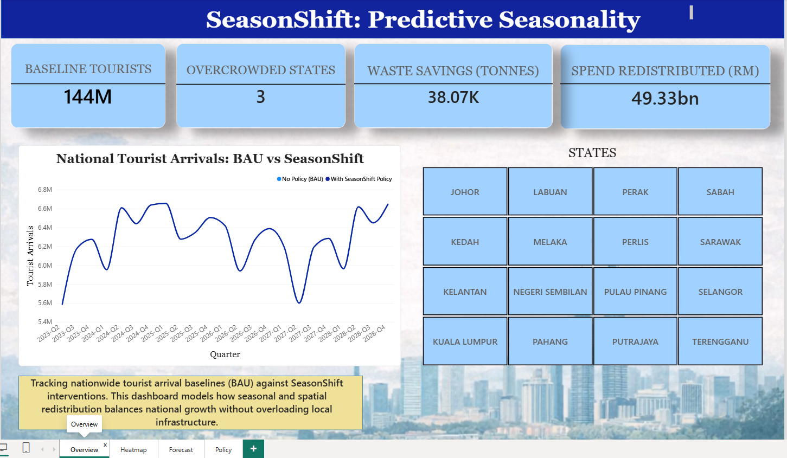
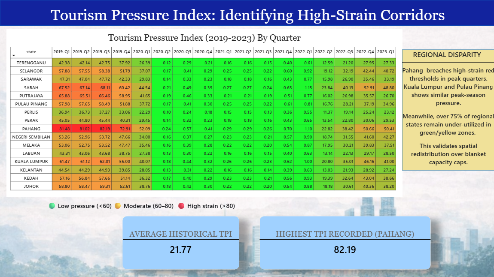
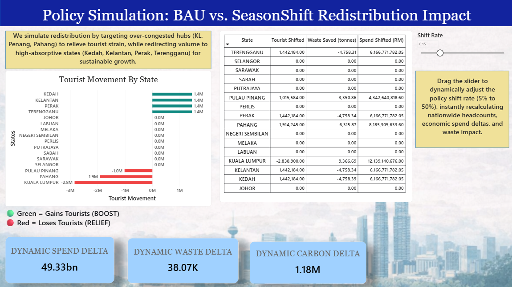

# SeasonShift: A Data-Driven Tourism Pressure Index and Predictive Seasonality Model for Sustainable Tourism Planning in Malaysia

**DOSM Datathon 2026 · Team Avengers · Universiti Putra Malaysia**

SeasonShift is a team analytics project that examines how tourism pressure is distributed across Malaysia's states and federal territories. It combines a quarterly **Tourism Pressure Index (TPI)**, a **Prophet time-series forecast**, and a **visitor-redistribution policy scenario** in an interactive four-page Power BI dashboard.


## Dashboard preview

### 1. National overview



### 2. Historical Tourism Pressure Index



### 3. Prophet forecast


### 4. Policy simulation



## Problem and objectives

Tourism demand is not evenly distributed across Malaysia. Some destinations attract visitor volumes that may place pressure on accommodation and local infrastructure, while other destinations may have capacity to receive more visitors. Looking only at national arrival totals can hide these spatial differences.

The project aims to:

1. Develop a quarterly, state-level Tourism Pressure Index using visitor demand, accommodation capacity, baseline occupancy, and seasonal context.
2. Forecast state-level tourism pressure through 2028 using Prophet.
3. Simulate a visitor-redistribution scenario and estimate how the redistribution could affect tourist spending and selected environmental indicators.
4. Present the analysis in an interactive Power BI dashboard for exploration and decision support.

## Analytical workflow

1. **Collect and prepare data** — bring together quarterly tourist arrivals, hotel inventory, average occupancy rates, calendar indicators, and spatial demand weights.
2. **Allocate demand by state** — derive state-level demand using fixed state demand-share weights; these are modelled allocations, not observed state-level arrival counts.
3. **Construct historical TPI** — combine demand, rooms, baseline average occupancy rate (AOR), and seasonal context into quarterly state-level TPI outputs.
4. **Forecast TPI** — use Prophet to project state-level TPI from 2023-Q2 through 2028-Q4.
5. **Simulate policy scenarios** — compare Business as Usual (BAU) with a SeasonShift redistribution scenario, then explore the outputs in Power BI.

The exact closed-form TPI weighting formula is not documented in the supplied artefacts. The report notes that the index was calculated upstream in Python/Excel and that its exact formula could not be reconstructed from the packaged Power BI file. The repository therefore documents the confirmed inputs and outputs without inventing a formula.

## Key findings

The figures below are based on the submitted report and the CSV outputs included in this repository.

### Historical TPI (2019-Q1 to 2023-Q1)

- The historical output contains **272 state-quarter records** across **16 Malaysian state/federal-territory units**.
- **Pahang** recorded the highest TPI: **82.19 in 2019-Q3**.
- The supplied historical output contains **3 Red-zone records**, all for Pahang in 2019-Q1, 2019-Q2, and 2019-Q3.
- The mean of the supplied historical TPI records is **21.77**.

### Forecast TPI (2023-Q2 to 2028-Q4)

- The forecast output contains **368 state-quarter records** across 16 units and 23 quarters.
- The mean TPI across the supplied forecast records is **49.20**.
- No forecast state-quarter record is classified as Red in the supplied output; the maximum forecast TPI is **74.21** (Pahang, 2025-Q1).
- These are model forecasts under the project's assumptions, not guaranteed future outcomes. Forecast backtesting metrics were not included in the submitted materials.

### Visitor-redistribution scenario

The policy scenario shifts modelled visitor demand away from three selected source hubs — **Kuala Lumpur, Pahang, and Pulau Pinang** — toward four receiving corridors — **Kedah, Kelantan, Perak, and Terengganu**. The three source hubs are case-study policy targets; they should not be described as three states that all crossed the historical TPI Red threshold. The historical output identifies Pahang as the only unit to enter the Red zone.

At the submitted baseline scenario, the dashboard reports approximately **RM49.33 billion** in redistributed spending, **38.07 thousand tonnes** of waste change, and **1.18 million tonnes CO2e** of carbon-footprint change. These dashboard indicators represent the **gross sum of absolute state-level changes** (origin-state reductions plus receiving-state increases). They are not net nationwide savings. In the supplied policy CSV, national totals for spending, waste, and carbon remain effectively unchanged between BAU and the policy scenario, consistent with a zero-sum redistribution design.

The supplied policy CSV implies approximately **5,768,732 one-way visitor reallocations** when the absolute state-level arrival changes are divided by two. The report describes this as approximately 5.79 million; the small difference should be reconciled against the original upstream workbook if an exact figure is required.

## Dashboard pages

| Page | Purpose |
|---|---|
| **Overview** | National tourist-arrival baseline, summary indicators, BAU versus SeasonShift trend, and state selection. |
| **Heatmap** | Historical quarterly TPI by state, with Green, Yellow, and Red pressure categories. |
| **Forecast** | Average and state-level forecast TPI through 2028, with state and year filters. |
| **Policy** | BAU versus redistribution scenario, state-level movements, and a shift-rate what-if control. |

See [`dashboard/README.md`](dashboard/README.md) for opening and navigation instructions.

## Repository contents

```text
SeasonShift-Tourism-Analytics-Datathon-2026/
├── README.md
├── dashboard/
│   ├── SeasonShift_Dashboard.pbix
│   ├── README.md
│   └── screenshots/
├── data/
│   ├── source/
│   ├── processed/
│   ├── outputs/
│   └── README.md
├── report/
│   └── SeasonShift_Datathon_2026_Report.docx
├── docs/
│   ├── METHODOLOGY_AND_LIMITATIONS.md
│   └── reference/
│       └── Dashboard_User_Guide_Original.docx
└── CITATION.cff
```

## Tools and technologies used

- **Microsoft Power BI Desktop** 
- **Python 3.12 (Google Colab), pandas, Prophet**
- **Microsoft Excel and CSV** 

## Team and acknowledgement

**Team Avengers** — Department of Mathematics and Statistics, Faculty of Science, Universiti Putra Malaysia.

- Kalvinn Roy A/L Daniel
- Arman Azad bin Shahrezad
- Puovelan A/L Kumaresan
- Shamalan A/L Vicneswaran

**Project supervisor:** Dr Ahmad Hakiim bin Jamaluddin.

The submitted report lists the team members but does not itemise each member's individual responsibilities. This repository therefore presents the work as a team project and does not assign unverified individual contributions.

## Sustainable Development Goal alignment

The project discusses potential alignment with:

- **SDG 8 — Decent Work and Economic Growth:** more balanced distribution of tourism-related economic activity.
- **SDG 12 — Responsible Consumption and Production:** monitoring and managing resource and waste pressure.
- **SDG 13 — Climate Action:** estimating carbon-footprint implications under the policy scenario.

These are project alignments and modelled potential impacts, not measured real-world outcomes.

## Data sources and references

The submitted report and guide identify the following source organisations and references:

- Department of Statistics Malaysia (DOSM) / [data.gov.my](https://data.gov.my/) — tourist arrivals, hotel inventory, and average occupancy data.
- Tourism Malaysia — average length of stay and tourism reference data.
- SWCorp Malaysia — waste-generation benchmark cited in the policy assumptions.
- SPAN — water-use benchmark cited in the policy assumptions.
- UK Department for Environment, Food & Rural Affairs / Department for Energy Security and Net Zero (DEFRA/DESNZ) — carbon benchmark cited in the policy assumptions.
- United Nations Department of Economic and Social Affairs and UN Tourism — sustainable tourism and SDG context.
